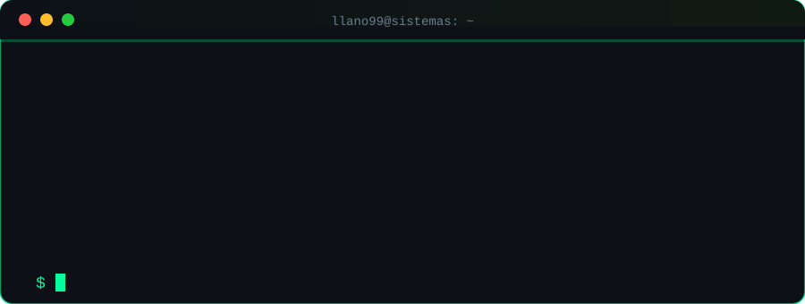

<div align="center">


[](https://github.com/llano99)



<br>


</div>

---

## `~/sobre-mi`

```bash
$ cat sobre-mi.md
> Estudiante en formación, enfocado en la administración de sistemas.
> Me gusta entender cómo funcionan las máquinas por dentro y automatizar lo repetitivo.
```

<details>
<summary><b>$ ls objetivos/</b> · pulsa para desplegar</summary>

- [x] Dominar la línea de comandos de Linux
- [x] Entender los principios de DevOps
- [ ] Montar un pipeline CI/CD propio
- [ ] Contenerizar un servicio con Docker
- [ ] Automatizar tareas con Bash y cron
- [ ] Certificarme como administrador de sistemas

</details>

---

## `~/stack`

<div align="center">

[](https://skillicons.dev)

</div>

---

## `~/estadisticas`

<div align="center">


</div>

---

## `~/serpiente`

<div align="center">


</div>

---

## `~/contacto`

<div align="center">

[](https://github.com/llano99)
<a href="https://www.linkedin.com/in/TU-USUARIO](https://www.linkedin.com/in/alejandro-llano-mart%C3%ADnez-8067603a4/">
  
</a>
<!-- Cambia TU-USUARIO y TU-CORREO por los tuyos y quita los comentarios -->
<!-- [](https://www.linkedin.com/in/TU-USUARIO) -->
<!-- [](mailto:TU-CORREO) -->

```bash
$ echo "Gracias por pasar por aquí 👋"
```


</div>

